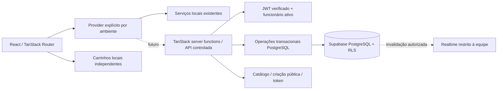

# Arquitetura do backend — proposta da Sprint 06.1

## Pré-implantação de 17/11/2026 — Sprint 06.3B

A migração **00300 continua pendente no hospedado**, com SHA-256 original c79e2a16a7e1411e52c6bf0789c41fa9ac88ea9aa2346e1aba0d483289d195e5. O dry run listou somente esse arquivo; nenhuma aplicação, conta ou configuração Auth foi alterada. A execução parou no primeiro ponto de aprovação. As duas migrações anteriores permanecem aplicadas.

A Data API foi reconfirmada por leitura de configuração: public e graphql_public expostos; private aparece como opção no painel, mas **não está selecionado/exposto**. Auth remoto: signup público true, confirmação de e-mail true, senha mínima 6, Site URL http://localhost:3000 e sem redirects adicionais. Esses valores exigem revisão/autorização separada antes de criar a equipe. O provedor Email e entrega de recovery/convites não foram comprovados; o proprietário informou não conseguir conferir o provedor.

A auditoria corrigiu dois problemas de logout: foco/polling durante mutação podia restaurar estado privado; erro retornado pelo SDK podia ser tratado como sucesso. Agora há exclusão entre login/logout/revalidação, estado privado removido enquanto aguarda e erro sanitizado com cookies sempre limpos. Isso não promete revogação imediata de JWT já emitido antes de seu exp, nem substitui homologação entre abas/navegador.

Resultados: **252 testes da aplicação (247 anteriores + cinco novos), 155 SQL locais e 12 checks Auth locais**, typecheck/build aprovados e lint sem erros/nove avisos anteriores. Browser indisponível, modo demo preservado, nenhum login/conta/PDV hospedado ativado. Ver [Sprint 06.3B](../sprints/SPRINT-06.3B.md) para configurações observadas, riscos, plano exato e aprovações separadas. As notas anteriores abaixo são históricas e não antecipam autorização de ativação.

## Atualização de 17/11/2026 — Sprint 06.3

A fundação hospedada (duas migrações) foi aplicada anteriormente após autorização e continua com escrita comercial bloqueada. Nesta sprint, a autenticação servidor-centrada por cookies e a preparação de perfis foram implementadas/testadas **somente localmente**. SDKs oficiais estão instalados; demo continua padrão, sem SDK administrativo no browser, sem ativação real automática e sem alteração de catálogo/localStorage.

O proprietário confirmou no painel **public e graphql_public** como Exposed schemas (private ausente na lista informada); isso é evidência manual, não uma prova da CLI. Auth hospedado, primeira conta/admin e nova migração 00300 não foram ativados. A migração nova, funções de perfis e bootstrap privado aguardam aprovação própria. Convites por endpoint não estão implementados/liberados. Resultados locais: **247 testes da aplicação, 155 SQL e 12 checks com Auth/REST reais locais**; browser indisponível.

Ver [guia de autenticação](AUTENTICACAO.md) e [Sprint 06.3](../sprints/SPRINT-06.3.md) para modos, flags, matriz, bootstrap, hash/plano e limites. O histórico/planejamento abaixo não deve ser interpretado como declaração de que Auth remoto está homologado ou de que a fundação ainda está pendente.

## Estado reconferido — Sprint 06.2C (17/11/2026)

As duas migrações de fundação **já estavam aplicadas**, após autorização explícita na etapa anterior. A conferência desta sprint foi somente de leitura/dry run no remoto: histórico com ambas as versões, hashes esperados, **upToDate: true e migrations: []**. Não houve nova aplicação, reparação, importação ou alteração de configuração. O texto histórico abaixo que menciona aplicação pendente deve ser lido conforme esse estado atualizado.

A stack local iniciou normalmente e passou nos **121 testes SQL**. A suíte da aplicação passou nos **200 testes na repetição isolada**; a primeira execução concorrente teve nove falhas, registradas sem alterar testes/timeouts. A auditoria hospedada reconfirmou dez tabelas/RLS/PKs, 71 constraints, 33 índices, nove policies de leitura e vinte triggers ALWAYS, com bloqueio de escrita para os papéis de API e proteção das tabelas privadas.

A ausência de grants privados foi comprovada; a lista completa de “Exposed schemas” da Data API hospedada não foi comprovada pela consulta de parâmetros/diff e permanece como verificação operacional antes de ampliar acesso. Não confundir configuração local com remota. Frontend e Lovable continuam preservados, sem SDK/Auth real/vendas remotas. Ver [relatório 06.2C](../sprints/SPRINT-06.2C.md) para evidências, divergência documental, avisos e limites. Nenhuma nova autorização de aplicação é solicitada para migrações já executadas; mudanças futuras exigem plano próprio.

## Estado validado — Sprint 06.2B

Em 17/11/2026, a fundação passou em PostgreSQL local 17.11: **121 testes SQL em dois arquivos (34 anteriores + 87 novos)** e **200 testes da aplicação**. Foram conferidos RLS nas dez tabelas, vinte triggers ALWAYS, privilégios efetivos, owner dos helpers e search_path vazio, papéis ativos/inativos e bloqueio de acesso direto às três tabelas privadas. A modelagem e as duas migrações não precisaram de correção.

O remoto `vila-rica-dev` (`yzxsuoxthkbzbkcumauz`, sa-east-1) foi inspecionado somente em read-only e por dry run: as duas migrações estão pendentes, sem tabelas public/private ou funções conflitantes encontradas. A aplicação hospedada **aguarda aprovação explícita**. Não confundir testes locais com comprovação de RLS hospedada. O frontend continua local, sem SDK/Auth real ou operações de venda. Os controles de RPCs/transações/retenção e os fluxos de autenticação abaixo continuam proposta futura, não foram liberados por esta validação.

Ver [Sprint 06.2B](../sprints/SPRINT-06.2B.md) para auditoria, limitações, hashes e plano de implantação/recuperação. O texto das etapas anteriores abaixo é contexto histórico e planejamento, sujeito a esse estado atualizado.

> Atualização Sprint 06.2A: para o Supabase externo `vila-rica-dev` (`yzxsuoxthkbzbkcumauz`, sa-east-1), vale a exceção específica de AGENTS.md. A administração ocorre pela CLI do proprietário, sem modificar o bloco gerenciado do Lovable. As migrações versionadas de fundação estão preparadas, mas não foram aplicadas ao remoto. A proposta histórica abaixo não é uma migração pronta. Ver [Sprint 06.2A](../sprints/SPRINT-06.2A.md).

Estado: preparação para revisão, sem Supabase provisionado, SDK instalado, conexão, autenticação real ou alteração do comportamento local. Lovable, SSR/Nitro, CSRF, rotas e ferramentas permanecem intactos. A Sprint 05.2 foi cancelada definitivamente.

## Auditoria do código atual

| Ponto                                    | Situação observada                                                                                       | Transição proposta                                                                                                |
| ---------------------------------------- | -------------------------------------------------------------------------------------------------------- | ----------------------------------------------------------------------------------------------------------------- |
| `services/contracts.ts`                  | CatalogService, OrderService e DemoService agrupados em AppServices; prévia opcional por compatibilidade | Preservar legado local; contratos remotos segregam catálogo, público e equipe; prévia e idempotência obrigatórias |
| `services/local/index.ts`                | Revalidação após 250 ms; snapshots; sequência calculada em memória; limpa carrinho público no serviço    | Adaptador remoto não limpa carrinho; UI limpa só após resposta confirmada; SQL transacional calcula tudo          |
| `services/local/store.ts`                | StoreData agrega produtos/categorias/pedidos; parser externo superficial                                 | Cache remoto validado, consultas paginadas e separadas por permissão                                              |
| `StoreContext.tsx`                       | Importa dataStore e localServices diretamente; useSyncExternalStore; preenche imagens ausentes no store  | Injeção explícita de provider de dados; operação de preenchimento permanece exclusiva do modo local               |
| `CartContext.tsx`                        | Guarda linhas localmente; addItem busca preço diretamente em dataStore                                   | Carrinho local consulta catálogo do provider; referência de preço não autoriza gravação                           |
| `counter-cart.ts`                        | add/review leem dataStore, complete guarda referência local                                              | Receber catálogo pelo provider, preservar rascunho em falhas, confirmar por resposta remota                       |
| `CounterCartContext.tsx` / counter-store | Estado local próprio com parser Zod, última venda e troco                                                | Continuar local; futura chave de tentativa vinculada ao conteúdo e ao operador, sem alterar chaves atuais         |
| `AdminSessionContext.tsx`                | Booleano persistido sem identidade ou senha                                                              | Provider Supabase Auth separado; booleano demo nunca vira JWT ou papel                                            |
| `persistent-store.ts`                    | Cache por módulo, eventos storage entre abas, erro de escrita só avisa                                   | Apenas carrinhos/demo; nunca usar para confirmar pedido remoto ou como fonte de permissões                        |
| `orders.ts`, `catalog.ts`, `pos.ts`      | Cálculo seguro JS, disponibilidade, categoria, status, schemas, quote e troco                            | Reutilizar validação de UX; implementar e testar equivalentes autoritativos no servidor; troco segue auxiliar     |
| `mock.ts` / catalog-product-images       | 8 categorias, 57 produtos/imagens e pedidos fictícios separados                                          | Manifesto só de catálogo usando createSeedCategories/createSeedProducts; sem importar pedidos                     |
| `acompanhar.tsx`                         | Lê StoreContext por número, apesar de existir getOrderByNumber                                           | Remover dependência de listagem de pedidos no modo remoto; endpoint de token com DTO restrito                     |

As quatro chaves `padaria-digital:demo:store:v1`, `padaria-digital:demo:cart:v1`, `padaria-digital:demo:admin-session:v1` e `padaria-digital:demo:counter-cart:v1` são preservadas. Não existe transação entre elas, isolamento entre operadores ou garantia de concorrência entre abas. Falha de localStorage pode deixar alteração somente em memória. Nenhum dado do navegador foi lido para migração ou apagado nesta sprint.

## Fronteiras propostas

A seleção de backend será explícita no ponto de composição, sem fallback de remoto para local. Timeout significa resultado desconhecido: consultar/repetir a mesma tentativa, nunca gerar um pedido demo. O código desta sprint não altera StoreProvider nem lê variáveis de ambiente automaticamente. `parseBackendPlan` é uma função pura de preparação; configurar `.env` não ativa backend. Não há adaptador Supabase implementado.

## Contratos e integração futura

`src/services/backend/contracts.ts` define PublicOrderService, StaffOrderService, RemoteServices e PublicOrderTracking. O tipo público usa lista positiva de campos, omitindo IDs internos, operador, nome/telefone/endereço, observações gerais e por item. Não é um alias de Order nem uma subtração informal de campos sensíveis. A implementação terá que validar respostas em runtime e mapear snake_case/UUID/timestamps para domínio. Tipos não são autorização nem validação de payload.

Preservar CatalogService no legado; no remoto as operações de escrita requerem admin e listagens da equipe podem incluir inativos. Catálogo público lê somente categorias ativas e produtos disponíveis; se futuramente a UI quiser mostrar indisponíveis, definir outra projeção aprovada. StaffOrderService lista com cursor e limite (proposto 50, máximo 100), e usa versão esperada para detectar conflito. DTO remoto exigirá UUIDs, quantidades 1–99, notas <=200, nome <=60, nome online >=2, telefone normalizado com 10/11 dígitos e endereço de entrega 8–160; balcão nome opcional, sem exigir telefone/endereço.

Criar operações por intenção (`createOnlineOrder`, `createCounterOrder`, `updateStatus`, `markPaid`), nunca aceitar updates arbitrários em orders. UUID local de tentativa criado por Web Crypto no primeiro envio e preservado nos retries; após mudança de conteúdo confirmado, criar outra tentativa. Não reutilizar automaticamente um rascunho demo como venda remota. Chave de status/recebimento também deve persistir até resolver resultado incerto. A sessão real deve isolar/desvincular rascunhos de terminal de outro operador mediante confirmação, sem apagar dados antigos implicitamente.

Realtime é invalidação de cache da equipe autenticada, seguida de refetch autorizado. Desconectar canais ao sair/desativar; recuperar eventos perdidos por refetch. Não publicar tabelas privadas, token ou dados pessoais em canais anônimos. Acompanhamento inicialmente por polling limitado no endpoint de token; não publicar pedidos para usuários anônimos. Storage não é necessário para as imagens locais atuais; eventual bucket público somente para assets comerciais, upload exclusivo admin com validação de tamanho/MIME, sem nomes pessoais.

## Configuração e implantação futura

`.env.example` contém apenas placeholders comentados e modo local. `parseBackendPlan` aceita somente chave pública no formato `sb_publishable_...`, URL HTTPS sem credenciais/query/fragmento e falha em configuração remota inválida; não admite fallback. Chaves legadas JWT não são aceitas por esse contrato inicial; qualquer compatibilidade futura exige revisão. A validação de formato não prova legitimidade da chave/projeto. Não enviar o objeto de ambiente completo a logs ou bundle. VITE_* são públicas; nenhuma senha, connection string, chave secreta ou service_role pode ter esse prefixo.

Segredos permanecem sob gestão do Lovable no servidor. Ambientes dev/homologação/produção devem ter projetos e credenciais separados, redirects Auth permitidos explicitamente e CORS limitado. Preservar o middleware CSRF e tratar também autorização, origem, limites e erros no novo endpoint. Nada foi alterado em `.lovable`, AGENTS.md, vite.config.ts, dependências ou bun.lock.

## Sequência da Sprint 06.2

1. Aprovar modelagem/permissões, fuso operacional e política de retenção; autorizar projeto de desenvolvimento e custos.
2. Solicitar ao Lovable o esquema revisado pelo fluxo de banco autorizado; não copiar a proposta como migração pronta.
3. Implementar RPCs, triggers, grants, rate limits e testes reais em banco descartável; nenhum frontend remoto antes dessas barreiras.
4. Criar contas individuais de teste, bootstrap controlado de admin e autenticação; testar usuário inativo e tentativas de escalada.
5. Importar catálogo pelo manifesto revisado e dry run, sem pedidos/dados pessoais; mapear IDs e revisar carrinhos antes do corte.
6. Implementar adaptador, respostas validadas e provider injetável, testes de falha sem fallback e acompanhamento seguro.
7. Homologar jornadas, concorrência, idempotência, RLS, vazamento de dados, browser e recuperação antes de autorizar implantação.
