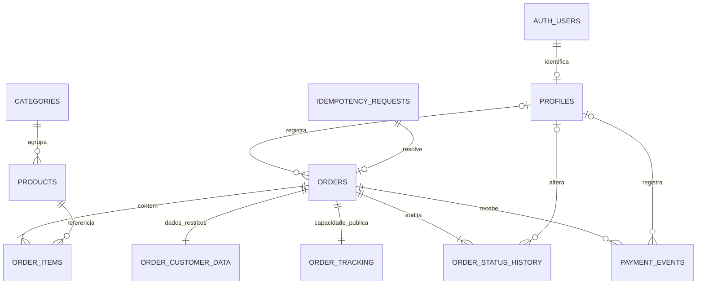

# Modelagem física — proposta para uma padaria

SQL de referência em [PROPOSTA-SQL.md](PROPOSTA-SQL.md); controles em [SEGURANCA.md](SEGURANCA.md). Não existe banco configurado nesta sprint. Não é um modelo multi-tenant.

## Convenções e dicionário

PKs UUID geradas no servidor, exceto profiles.id, FK de auth.users. Todos os created_at/updated_at usam timestamptz, default now(); PostgreSQL armazena instantes, e relatórios convertem para `America/Porto_Velho`, proposta sujeita à confirmação. O frontend atual continua no fuso do navegador. FKs usam RESTRICT, sem cascata de exclusão histórica. Exclusão definitiva bloqueada por grants/triggers propostos. Não armazenar senhas em profiles.

| Tabela / campo                                    | Tipo e nulabilidade                                 | Regra / finalidade                                                                                                    |
| ------------------------------------------------- | --------------------------------------------------- | --------------------------------------------------------------------------------------------------------------------- |
| profiles.id                                       | uuid PK FK auth.users, obrigatório                  | Conta individual; desativar em vez de excluir usuário referenciado                                                    |
| profiles.full_name                                | text obrigatório                                    | 2–80 caracteres normalizados                                                                                          |
| profiles.role / active                            | text / boolean obrigatórios                         | admin ou atendente; default atendente e false; promoção só por fluxo administrativo                                   |
| profiles.created_at / updated_at                  | timestamptz obrigatórios                            | Auditoria de cadastro; nunca metadados do usuário como fonte de papel                                                 |
| categories.id / source_id                         | uuid PK / text único opcional                       | Identidade remota / origem estável de importação                                                                      |
| categories.name / description                     | text obrigatório / text obrigatório default vazio   | Nome normalizado 2–80, descrição <=500; nome único case-insensitive após normalização de espaços                      |
| categories.active / sort_order                    | boolean / integer obrigatórios                      | Desativação lógica; ordenação >=0                                                                                     |
| products.id / source_id                           | uuid PK / text único opcional                       | Unicidade da origem, não do código comercial                                                                          |
| products.commercial_code                          | text opcional                                       | Código original, sem UNIQUE; dois 362 são intencionais                                                                |
| products.category_id                              | uuid FK obrigatório                                 | Categoria preservada; venda exige ativa                                                                               |
| products.name / description                       | text obrigatórios                                   | 2–80 / <=500; nomes de produtos não precisam ser únicos                                                               |
| products.price_cents                              | bigint obrigatório                                  | >0 e <=9007199254740991; serviço limita produto × quantidade e soma                                                   |
| products.image_url                                | text obrigatório default vazio                      | <=2048; galeria local conhecida, vazio ou HTTPS sem credenciais; RPC valida além do CHECK de tamanho                  |
| products.available                                | boolean obrigatório                                 | Flag individual, não substitui active da categoria                                                                    |
| categories/products timestamps                    | timestamptz obrigatórios                            | Criado/atualizado pelo servidor, não pelo payload do cliente                                                          |
| orders.id / order_number                          | uuid PK / bigint identity unique                    | Número gerado concorrentemente; começa em 1001, admite lacunas e não é credencial                                     |
| orders.channel / fulfillment                      | text obrigatórios                                   | online ou balcao / retirada ou entrega; balcao sempre retirada                                                        |
| orders.status                                     | text obrigatório                                    | pendente, em_preparacao, pronto, saiu_para_entrega, concluido, cancelado; default pendente                            |
| orders.payment_method / payment_status            | text obrigatórios                                   | pix, dinheiro, cartao / pendente, pago; pagamento independente do preparo                                             |
| orders.total_cents                                | bigint obrigatório                                  | Total calculado no servidor, >0 e dentro do limite seguro JS                                                          |
| orders.created_by                                 | uuid FK profiles opcional                           | Obrigatório para balcao, null para checkout público; derivado de identidade verificada                                |
| orders.idempotency_key                            | uuid obrigatório unique                             | Por tentativa de criação; sem reutilização para outro conteúdo                                                        |
| orders.version                                    | integer obrigatório default 1                       | Concorrência otimista em comandos da equipe                                                                           |
| orders timestamps                                 | timestamptz obrigatórios                            | UTC de armazenamento; criação usada nos indicadores atuais                                                            |
| private.order_customer_data.order_id              | uuid PK FK orders                                   | Separação física de dados pessoais; linha mesmo em venda anônima                                                      |
| customer_name / customer_phone / delivery_address | text opcionais                                      | Limites 60 / 10–11 dígitos / 160; online exige nome/telefone, entrega exige endereço; RPC valida regras entre tabelas |
| private.order_customer_data.notes                 | text opcional                                       | <=200; não vai ao acompanhamento público                                                                              |
| private.order_tracking.order_id / token_hash      | uuid PK FK / bytea único                            | SHA-256 do token de 32 bytes aleatórios; token bruto só resposta de criação ou replay protegido                       |
| private.order_tracking.expires_at                 | timestamptz obrigatório                             | Prazo proposto 30 dias; definir rotação/revogação/reemissão controlada                                                |
| order_items.id / order_id / product_id            | uuid PK / FK / FK obrigatórios                      | Uma linha por produto em cada pedido; vínculo restrito                                                                |
| order_items.product_name                          | text obrigatório                                    | Snapshot 2–80, imutável                                                                                               |
| order_items.unit_price_cents / quantity           | bigint / smallint obrigatórios                      | Preço >0, quantidade 1–99; multiplicação cabe no limite seguro                                                        |
| order_items.notes / subtotal_cents                | text opcional / bigint gerado                       | Notas <=200, subtotal = preço × quantidade; snapshot imutável                                                         |
| order_items.created_at                            | timestamptz obrigatório                             | Instante de gravação                                                                                                  |
| order_status_history.id / order_id                | uuid PK / FK obrigatórios                           | Histórico append-only                                                                                                 |
| previous_status / new_status                      | text opcional / text obrigatório                    | Criação null → pendente; demais seguem máquina de estados                                                             |
| changed_by / created_at                           | uuid FK opcional / timestamptz obrigatório          | null apenas na criação pública; identidade da equipe nas alterações                                                   |
| payment_events.id / order_id                      | uuid PK / FK obrigatórios                           | Trilha de recebimento, sem atualização/exclusão                                                                       |
| payment_method / amount_cents / event_type        | text / bigint / text obrigatórios                   | Método do pedido, valor exatamente total, tipo inicial recebido; um evento recebido por pedido                        |
| registered_by / created_at                        | uuid FK obrigatório / timestamptz obrigatório       | Operador real; balcão pago registra no mesmo commit                                                                   |
| private.idempotency_requests.key                  | uuid PK                                             | Reservada atomicamente antes de gravar; segredo de tentativa não vai em logs/URL                                      |
| scope / actor_id / payload_hash                   | text / uuid opcional / bytea obrigatoriedade no SQL | Separar online, balcão, status, pagamento; replay exige mesmo ator/escopo/hash                                        |
| order_id / response_ciphertext                    | uuid FK opcional / bytea opcional                   | Resultado e resposta cifrada (token incluído) para replay; só concluir transação com resultado gravado                |
| created_at / expires_at                           | timestamptz obrigatórios                            | Prazo mínimo de replay proposto 7 dias; após expirar jamais repetir gravação da mesma chave                           |

## Integridade além dos CHECKs

Múltiplas linhas não podem ser validadas com CHECK simples: função transacional e triggers diferidos devem exigir ao menos um item, total igual à soma e relação coerente entre pagamento/evento. Histórico inicial é obrigatório. Updates de preço/nome/categoria não podem reescrever snapshots. Orders não aceitam edição de itens, canal, recebimento, total, identidade ou pagamento fora dos comandos autorizados.

Disponibilidade é verificada com bloqueio de linhas de produtos e categorias em ordem estável por UUID; alteração concorrente de catálogo espera o commit. Edição pode manter a categoria inativa atual (sem liberar venda), mas criação/transferência exige ativa, como no serviço local. Normalizar texto antes da unicidade, preservando acentos; revisar collation pt-BR no banco alvo para equivalência à UI.

Pagamento inicial online é sempre pendente. Balcão recebido gera exatamente um evento pelo total, nunca pelo dinheiro entregue. Marcar pago só quando pendente e não cancelado; pode ocorrer após concluído. Cancelar pedido pago mantém evento e status pago, sem estorno; dashboard exclui cancelados. Cálculo de troco permanece local, fora das tabelas financeiras.

## Índices e relatórios

Unicidade de source_id, nome normalizado de categoria, order_number, idempotency_key, token_hash e (order_id, product_id). Índices de catálogo por categoria/ativo/disponível; pedidos por created_at/id para cursor, status/created_at e channel/created_at; filhos por order_id e created_by/changed_by/registered_by para FKs/auditoria. Não indexar telefone/nome para acesso público.

Indicadores usam intervalos `[início do dia, início do próximo dia)` convertidos de America/Porto_Velho para UTC e índices em created_at. Valor pedido e ticket médio usam não cancelados; receitas recebidas usam não cancelados pagos. Preservar agrupamento por **data de criação**, mesmo se payment_events.created_at for posterior. Relatório por recebimento efetivo é outro indicador futuro, sem mudança silenciosa do dashboard.

## Decisões pendentes

Revisar prazo de token, retenção de dados pessoais/auditoria/idempotência, recuperação segura de comprovante/token, gestão de funcionários e fuso com o proprietário. Bigint do PostgreSQL pode chegar como string pela API: adaptador deverá verificar inteiro seguro antes de converter; não perder precisão ao fazer Number sem validação. O SQL é proposta, sem testes de banco nesta etapa.
